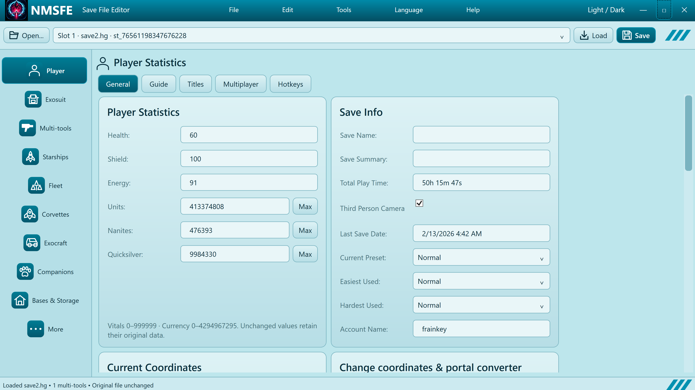
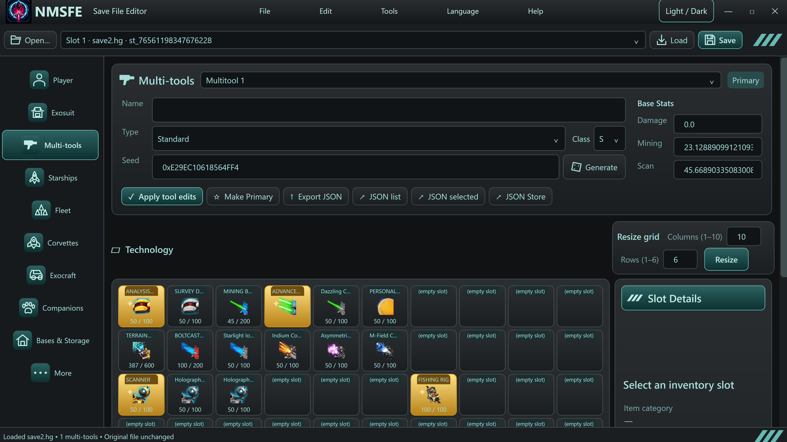
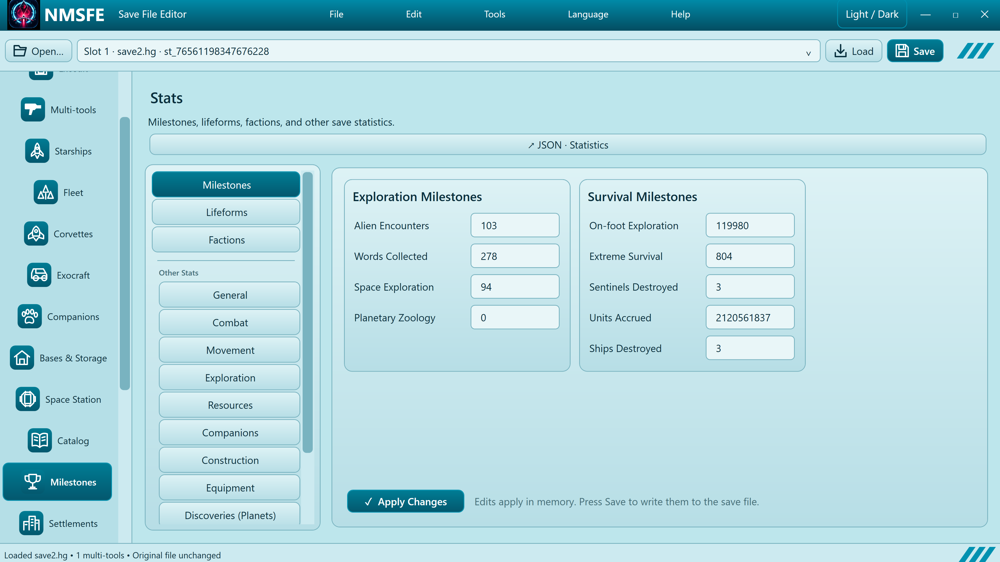

# NMSFE — Save File Editor

A standalone WPF migration alongside the existing NMSE editor.

## Available now
- Approved aqua/charcoal themes; richer light shading, vector pictograms, full Generate label.
- Sidebar More/Less expands additional pages inline.
- Player: General, Guide, Titles, Multiplayer and Hotkeys. General includes stats/currency Max, save metadata/camera/presets, current coordinates/state/system information, editable coordinates/portal glyph converter/roulette, purple warp synchronization, outfits and battle timing/trigger. Guide and Titles use account data with filtering and bulk controls. Hotkeys cover all three contexts, parameter editing and import/export. Multiplayer remains explicitly experimental and requires enabling edits.
- Exosuit: Cargo/Technology inventories and slot amount/maximum/damage editing.
- Multi-tools: selection; name/type/class/seed/base stats; primary selection; real inventory/slot editing; JSON export.
- Save updates the loaded Steam/GOG save with a verified staged data/metadata pair and an automatic backup under the profile's `.nmse-next-backups` folder.
- Existing metadata build version and alternate difficulty tags are preserved. A changed-on-disk source is rejected until reloaded. Failed pair replacement restores the earlier data.

All 16 navigation pages now display their corresponding data. Starships, Fleet, Exocraft, Companions, Bases & Storage, Catalogue, Milestones, Settlements, ByteBeats and Account Rewards have searchable record selectors, nested detail navigation and typed editing of existing fields. Inventory sections display actual slots and their state. Account rewards load the companion accountdata.hg and participate in verified save/backup/conflict protection when edited.

Export Settings supports editable/importable/exportable profiles. Raw JSON provides a lazy tree and validated subtree editing; Database Search uses the bundled item database.

Player save-slot utilities support Steam/GOG, extracted PS4/Switch game saves and existing Xbox WGS/XGS containers. Open offers format-specific file/container selection. Console player edits use staged verification, exact backups and conflict/rollback handling; Xbox sibling containers participate together. Slot copy/move/swap/delete and bidirectional transfers are covered by temporary fixtures. Existing Xbox destination slots are required. Retail encrypted PS5 saves, monolithic memory.dat, creating Xbox slots and console account-reward writes remain unsupported; cross-account ownership migration is not performed.

Epic/Android are not listed on the publisher's current platform selector; no corresponding save adapter was invented. iOS/iPadOS exists, but compatible accessible save files were not established, so mobile integration remains deferred. See docs/platform-compatibility.md.

This is a progressive migration, not full original-editor feature parity. Specialized add/remove/resize/drag/drop, record import/archive, advanced workflows and direct-save support for other platforms remain to be migrated. Empty collections show an empty state.

## Run
On Windows with the .NET 10 SDK installed:

```powershell
dotnet run --project Desktop/Desktop.csproj
```

Select an existing save and Load, or use Open. Edits remain in memory until Save. Light / Dark switches the theme. 

## Build and checks
Requires .NET 10 Desktop Runtime/SDK on Windows.

```
dotnet build Desktop/Desktop.csproj
dotnet run --project Checks/Checks.csproj -- Resources
dotnet run --project Desktop/Desktop.csproj -- --open <save-path> --verify-ui
```

Engine checks use synthetic temporary profiles for direct writes, metadata preservation, backup, failure rollback and external-change protection. A real save8.hg is read to verify compressed-copy roundtrip and source hash preservation. UI checks exercise both themes, three widths, More expansion, mixed slot states, all 16 pages, Player/Exosuit/Multi-tools edits and repainting. Build outputs are generated locally and are not stored in the repository.

## Screenshots







## Source and license
Derived engine snapshot: https://github.com/vectorcmdr/NMSE . Original source is under Engine/Upstream; see LICENSE (AGPL-3.0). Resource data/images came from the existing checkout. The new UI has no Windows Forms host or reference.

